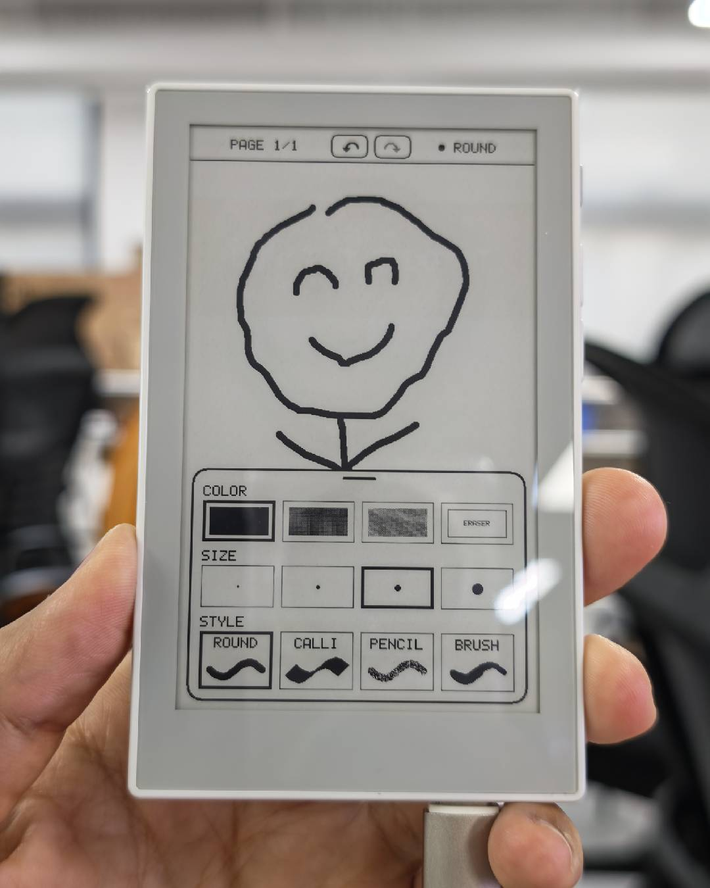

# reTerminal Sticky Handwriting Pad

[English](README.md) | 简体中文

手指在屏幕上划过即可书写，侧键翻页，AI 键单击休眠、长按打开清空确认框。基于 `sticky_demo_limengdu` 的板级驱动（SSD1677 电子纸、GT911 触摸、电源锁存）。



## 操作

| 按键 | 动作 |
| --- | --- |
| Page Up（侧键上） | 上一页 |
| Page Down（侧键下） | 下一页；已在最后一页时新建空白页（最多 20 页） |
| AI 键单击 | 进入深度睡眠；睡眠中单击唤醒 |
| AI 键长按 1 秒 | 全刷并弹出"清空本页"确认框，点 CLEAR 清空、点 CANCEL 取消 |

- 状态栏中间的 ↶ / ↷ 按钮撤销、重做。每页独立记录最多 50 步（笔画、橡皮擦、清空页面都可撤销），不可用时按钮图标变灰。撤销历史随笔记一起保存，睡眠唤醒或重新上电后仍可撤销。
- 屏幕底部中间露出一个圆角把手。**点把手**或**从屏幕最下方往上滑**，弹出圆角浮动工具栏；**往下滑、点顶部横条或点工具栏外**收起。工具栏可选：
  - 颜色：黑、深灰、浅灰、白（橡皮擦）
  - 粗细：4 档（半径 1/2/4/7 px）
  - 笔触：ROUND 圆头、CALLI 45° 扁头书法、PENCIL 颗粒铅笔、BRUSH 速度感应毛笔
- 灰色笔迹书写时先以抖动图案快速显示，停笔 1.5 秒后自动灰度全刷一次，显示真实灰阶。
- 1 分钟没有触摸和按键，自动进入深度睡眠。
- 睡眠前左上角显示月亮图标（与参考固件的睡眠指示相同），并把改动过的页面写入 Flash 的 `notes` 分区；唤醒或重新上电后自动恢复全部页面和当前页。
- 竖屏使用（按键在右侧），顶部状态栏显示 `PAGE n/m` 和当前画笔。从底部 48 px 内起笔视为工具栏手势，不会画线。

## 编译与烧录

硬件为 reTerminal Sticky（ESP32-S3R8、32 MB Flash、SSD1677 电子纸、GT911 触摸），竖屏使用，按键朝右。电脑需要安装 PlatformIO Core；平台版本由 `platformio.ini` 固定为 `espressif32@6.11.0`，组件版本记录在 `dependencies.lock` 中。

在项目根目录执行：

```sh
pio run -e sticky-release
```

用 USB 数据线连接设备后烧录并查看日志：

```sh
pio run -e sticky-release -t upload
pio device monitor
```

`sticky-debug` 环境会打开更多日志。

## 实现要点

- `src/input/sticky_touch.cpp`：10 ms 轮询 GT911，输出 Down/Move/Up 采样流，队列容量 1024，屏幕刷新期间不会丢点。GT911"数据未就绪"不再当作抬笔；短于 40 ms 的断触会被桥接成同一笔，单次 I2C 失败也不会断笔。
- 局刷耗时：串口会打印 `display=refresh_partial convert_ms=… write_ms=… waveform_ms=…`。SPI 时钟为 20 MHz（`kSpiClockHz`），若出现花屏改回 10 MHz。
- `src/handwrite/handwrite_app.cpp`：负责页面、工具栏、按键和触摸事件；画笔效果由 `handwrite_brush.cpp` 绘制。有新笔迹时局刷，页面切换和灰度显示使用全刷。每页在 PSRAM 中保留一份 2bpp 画布（约 94 KB/页）。
- `src/board/pin_config.h` 定义侧键、AI 键、屏幕和触摸控制器的引脚。
- 笔迹在进入睡眠时保存；断电前单击 AI 键，等月亮图标出现、设备进入睡眠后再断电。
- `partitions.csv` 把参考工程的 `assets` 分区换成了 2 MB 的 `notes` 分区（页面按 2bpp 灰度原样保存，含画笔设置）和 4 MB 的 `history` 分区。
- 撤销历史用只追加日志保存：每一步只写一次 Flash，入睡时只追加新步骤并更新一个小索引；日志写满时自动从头重写。记录带校验和与代次号，保存中途断电最多丢失撤销历史，不影响笔记。

## 真机验证步骤

1. 编译并烧录 `sticky-release`，确认启动后出现 `PAGE 1/1`。
2. 连续书写几笔，打开底部工具栏，逐一切换四种笔触、四档粗细和四种颜色。
3. 点撤销、重做，确认笔迹恢复；长按 AI 键，分别测试取消和确认清空。
4. 用侧键新建和切换页面，确认每页保留自己的笔迹与撤销记录。
5. 单击 AI 键保存并休眠，再唤醒，确认页面、画笔和撤销记录恢复；保存休眠后重新上电再次检查。
6. 静置一分钟，确认设备自动保存并进入睡眠。

## 源码结构

程序从 `src/main.cpp` 的 `app_main()` 启动，依次初始化电源、充电检测、共享 SPI、屏幕、触摸和按键，再进入 `handwrite_app_run()`。应用循环读取触摸和按键，把笔画交给画笔模块绘制、把修改交给撤销模块记录，最后刷新屏幕；休眠时先保存页面，再保存撤销记录。

项目地址：<https://github.com/limengdu/reterminal_sticky_handwriting_pad>。

## 固件下载

[v0.1.0 Release](https://github.com/limengdu/reterminal_sticky_handwriting_pad/releases/tag/v0.1.0) 提供已通过真机测试的固件、烧录清单和 SHA-256 校验值，来自本项目原始 `sticky-release` 编译产物。

## 许可证

[MIT](LICENSE)，Copyright 2026 limengdu。
